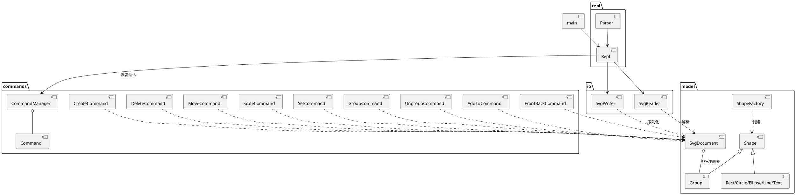

# SVG 命令行编辑器 —— 架构方案与过程记录

> Lab1 Phase 1：SVG 编辑器（CLI）。本文件是课程要求的提交物之一（放在 `doc/README.md`）。

## 1. 架构方案

### 1.1 模块划分

按"领域模型 / 命令 / 持久化 / 界面"四层组织，每个类独立成文件（文件名 = 类名）。

| # | 模块 / 文件 | 职责 |
|---|---|---|
| 1 | `src/model/Shape.ts` | 图形抽象基类（富领域模型）：统一持有几何/样式属性，定义 `move` / `scale` / `toSVG` / `treeLine` / `clone` / `settableAttrs`。 |
| 2 | `src/model/Group.ts` | 复合节点（容器），`g` 类型；`add` / `remove` / `insertAt`，并递归下沉 `move` / `scale`。 |
| 3 | `src/model/Rect·Circle·Ellipse·Line·Text.ts` | 五种叶子图形，各自负责自身几何与 SVG 序列化。 |
| 4 | `src/model/ShapeFactory.ts` | 图形工厂：类型名 → 类。**作业允许的"按名字分派"之一**。 |
| 5 | `src/model/SvgDocument.ts` | 文档模型：画布根 `svg` + 全局 `id` 注册表，保证 id 唯一、可定位，并提供层级查询。 |
| 6 | `src/commands/Command.ts` | 命令接口：`execute()` / `undo()` / `undoable`。 |
| 7 | `src/commands/CommandManager.ts` | 撤销/重做栈，并实现"IO 命令后禁用撤销、下一次编辑重新解禁"的规则。 |
| 8 | `src/commands/*Command.ts` | 各编辑命令（Create / Delete / Move / Scale / Set / Group / Ungroup / AddTo / FrontBack）。 |
| 9 | `src/io/SvgWriter.ts` | 把文档序列化为 SVG 文本（可直接在浏览器打开）。 |
| 10 | `src/io/SvgReader.ts` | 解析 SVG 文本为文档；缺 `id` 的元素按 `标签名+序号` 自动补并打印警告。 |
| 11 | `src/repl/Parser.ts` | 命令分词：支持双引号包裹含空格参数与 `in` 子句。 |
| 12 | `src/repl/Repl.ts` | 命令分发（**作业允许的"按名字分派"之二**）与 `tree` / `show` 显示。 |
| 13 | `src/main.ts` | 入口：交互式 REPL 或脚本回放（`npm run demo`）。 |

> 注：`canvas` 属 IO 类命令（不进入撤销栈），由 `Repl.doCanvas` 直接处理，与 `init`/`read`/`save` 同族；其语义简单（仅改画布宽高），故不建模为 `Command`。其余 9 类"编辑命令"见 `src/commands/*Command.ts`。

### 1.2 组件图（PlantUML）

> 说明：所有命令都只依赖 `model`，命令内部通过 `SvgDocument` 的注册表与层级 API 操作图形，不直接耦合具体图形类型。

### 1.3 命令参考（完整命令集）

全部命令均可经 `npm run cli` 交互式输入，或用 `npm run demo` 回放脚本。下表为完整命令集；**IO 类命令执行后撤销被禁用**，直到下一次编辑命令。

| 命令 | 语法 | 语义 | 类别 |
|---|---|---|---|
| `init` | `init [w] [h]` | 新建空白画布（默认 800×600），重置撤销栈 | IO |
| `read` | `read <file.svg>` | 载入 SVG 文件为当前文档；缺 `id` 元素自动补 `id` 并打印 `warning` | IO |
| `save` | `save [file.svg]` | 导出为 SVG 文本（可在浏览器打开）；默认上次 `read` 路径 | IO |
| `canvas` | `canvas [w] [h]` | 无参显示画布尺寸；带参修改尺寸 | IO |
| `create` | `create <type> <id> [params…] [in <c>]` | 创建图形（rect/circle/ellipse/line/text/g），可指定父容器 | 编辑 |
| `delete` | `delete <id>` | 删除图形及其全部子孙 | 编辑 |
| `move` | `move <id> <dx> <dy>` | 平移（相对位移） | 编辑 |
| `scale` | `scale <id> <factor>` | 等比缩放（factor>0；容器递归下沉到子孙） | 编辑 |
| `set` | `set <id> <attr> <value>` | 修改属性（限白名单，见 `SvgDocument.SETTABLE`） | 编辑 |
| `group` | `group <gid> <id>…` | 新建容器收集已有图形（禁止把容器移入自身/子孙） | 编辑 |
| `ungroup` | `ungroup <gid>` | 解散容器，子节点提升回原父 | 编辑 |
| `addto` | `addto <gid> <id>` | 把已有图形移入容器 | 编辑 |
| `front` | `front <id>` | 同级置顶（z-order 最前） | 编辑 |
| `back` | `back <id>` | 同级置底（z-order 最后） | 编辑 |
| `tree` | `tree [id]` | 显示结构树；缺参从根 `svg` 开始 | 查询 |
| `show` | `show <id>` | 显示某图形属性明细（含父容器） | 查询 |
| `undo` | `undo` | 撤销上一编辑命令 | 控制 |
| `redo` | `redo` | 重做 | 控制 |

> 分派点：命令名经 `Repl` 分派（第 2 节已标注为受控分派之一）；`create` 的 `<type>` 经 `ShapeFactory` 分派（受控分派之二）。

## 2. 设计模式的选择

**强制要求：Command 模式**，并辅以 **Composite 模式**。

- **Command 模式**：每个"图形编辑类"命令实现 `Command` 接口，`CommandManager` 持有 `undo` / `redo` 两个栈。一次 `execute()` 入 undo 栈并清空 redo 栈；`undo()` 弹出并执行反向操作。`IO 类`命令（init / read / save / canvas 改尺寸）调用 `markIO()`，使 `undo`/`redo` 被禁用直到下一次编辑命令（见 `CommandManager`）。这精确满足了作业 4.3 的粒度与禁用规则。
- **Composite 模式**：`Group` 与五种叶子都继承自 `Shape`。对调用方而言，"容器"与"叶子"是同一类东西——`move` / `scale` / `delete` 作用于 `Group` 时递归下沉到全部子孙，命令层无需 `if (isGroup)` 之类的分支，杜绝了"贫血模型 + 到处 `switch(tag)`"的反模式。

**刻意保留的两处分派点**（作业 2.1 允许的两处）：① `Repl` 的命令名 → 实现（switch）；② `ShapeFactory` 的类型名 → 类（registry）。已在架构文档中标注为受控的"待重构"边界，未来可平滑替换为插件注册表。

## 3. 依赖方向规则

- `model` 层**零出向依赖**（不认识 commands / io / repl），是稳定的内核。
- `commands` / `io` 仅依赖 `model`，不知道界面层。
- `repl` 依赖 `model` + `commands` + `io`，是组装层。
- `main` 仅依赖 `repl`。
- 规则：**上层可依赖下层，下层不得反向依赖上层**。任何违反（例如在 `model` 里 import `repl`）即记为待处理项。当前实现无违反。

## 4. 变化点假设

我认为未来最可能变化、并已为之留接口的地方：

1. **新增图形类型**（如作业 4.4 的复合图形 `box`）：只需在 `ShapeFactory` 注册 + 新增一个叶子/插件类，内核其余代码零改动。
2. **持久化格式扩展**（除 SVG 外支持其它格式）：只动 `io` 层，模型与命令不受影响。
3. **交互界面迁移**（REPL → GUI / Web / 远程 API）：只动 `repl` + `main`，核心能力不变。
4. **撤销策略升级**（如支持命令宏、事务）：集中在 `CommandManager` 一处。
5. **分派方式插件化**：把两处 switch/registry 换成可扩展注册表，已在第 2 节标注。

之所以"留"：这些边界都用稳定的接口（Command 接口、Shape 基类、文档 API）封住，新变化被关进单一模块，不会扩散。

## 5. 过程记录

本作业由我与 AI 协作完成，关键节点：

- **需求澄清**：先通读作业文档，明确交付物为"代码（git + `final` 标签）+ `doc/README.md`"，并锁定命令集、错误约定、`tree`/`show` 显示格式与 undo 粒度。
- **骨架先行**：先定分层（model / commands / io / repl），再逐层填充，保证依赖方向从一开始就是单向的。
- **关键难题与纠正**：
  - `read` 解析 SVG 时，叶子标签可能非自闭合，需用栈 + 游标回跳正确处理 `</text>` 的内容捕获，并避免误 pop 父容器；
  - `group` / `addto` 的"容器移入自身或子孙"环检测，借助 `SvgDocument.isDescendant` 统一处理；
  - `undo` 后若有新编辑需清空 redo 栈，且 IO 命令后撤销被禁用——这些都在 `CommandManager` 集中实现并通过 `demo.session` 回放验证。
  - 回放扩展 `demo.session` 时发现 `ungroup` 误将"父为画布根的顶层组"判为画布根而禁止解散；修正为仅禁止解散画布根 `svg` 本身（`UngroupCommand`），顶层容器现已可正常解散。
- **验证驱动**：每写完一层就用 `npm run demo` 回放作业第 6 节典型会话，对照文档示例逐行核对输出。

## 6. 一致性自查

- **模块划分**：实际目录与第 1.1 节方案**一致**（每个类独立成文件，分层与表格吻合）。
- **依赖方向**：`model` 层无对上层（commands / io / repl）的 import；`grep` 确认无反向依赖。**无违反**。

## 7. 质量保证手段

1. **类型安全**：`tsconfig` 开启 `strict`，`npx tsc --noEmit` 零错误。
2. **端到端回放**：`demo.session` 复刻作业第 6 节"典型会话"，覆盖 `init / create / group / tree / move / undo / redo / set / group(错误) / delete / undo / save / read(缺 id 警告) / tree`。运行输出与文档示例**逐行一致**（例如 `circle#c1 moved back to (100,100)`、`error: cannot group a container into its own descendant: markers`、`rect#box restored into g#markers`、`warning: assigned id rect1 to unnamed <rect>`）。
3. **产物可用**：`save` 生成的 `.svg` 是合法 SVG，可直接在浏览器打开；`npx tsc` 编译后 `node dist/main.js` 与 `npx tsx src/main.ts` 两种启动方式均验证通过。
4. **提交历史可追溯**：开发过程按"骨架 → 模型 → 命令 → 读写/界面 → 文档"分步提交，非一次性大提交，并打 `final` 标签。
5. **命令全覆盖且可复现**：在作业第 6 节最小会话基础上，`demo.session` 额外演示了 `scale`/`show`/`front`/`back`/`addto`/`ungroup`/`canvas` 等其余已实现命令；`npm run demo` 可一键复现全部 18 个命令，输出均符合规范约定（如 `error: cannot group a container into its own descendant: markers`）。
